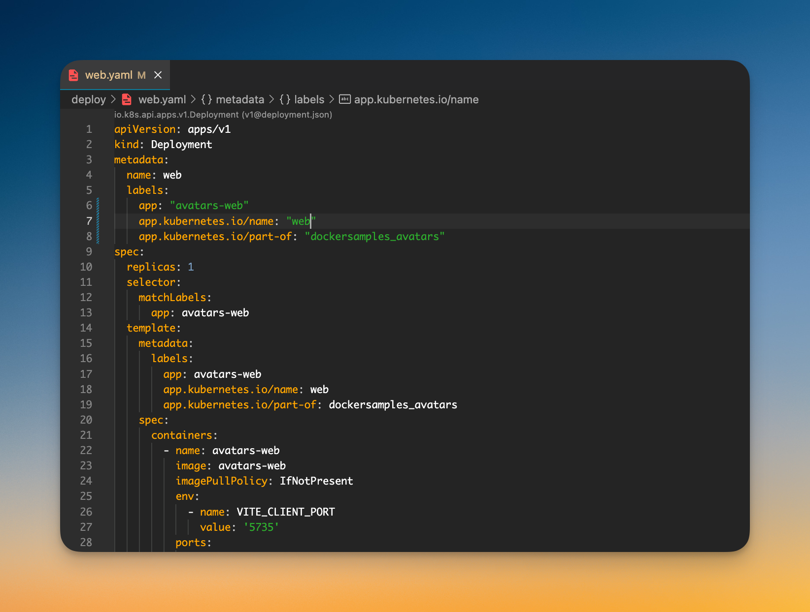
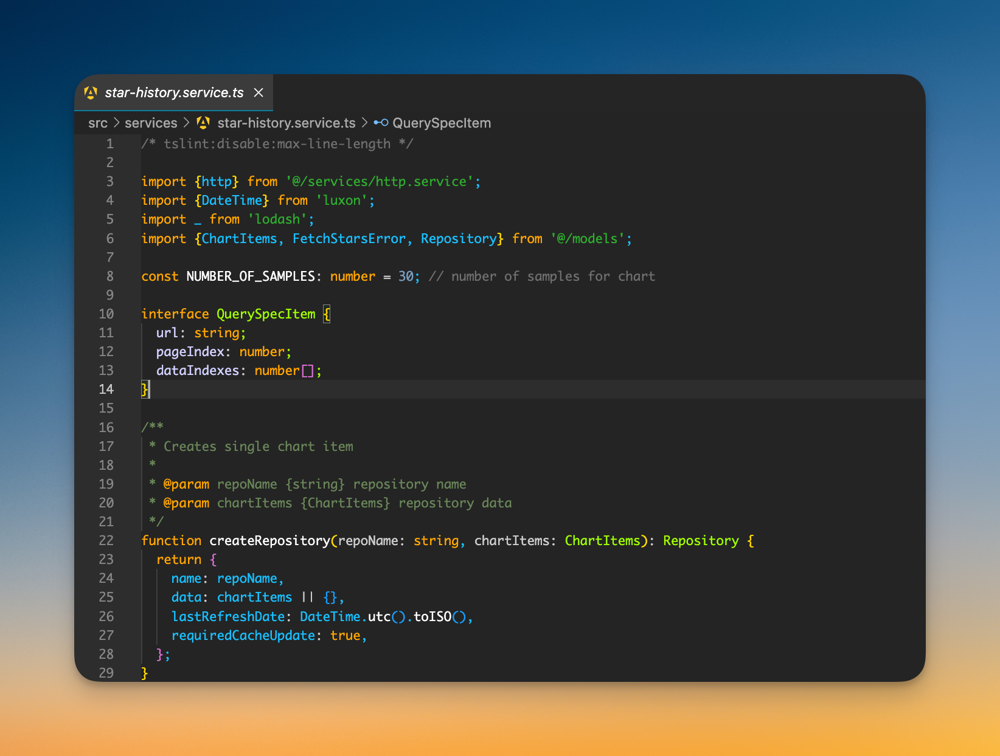
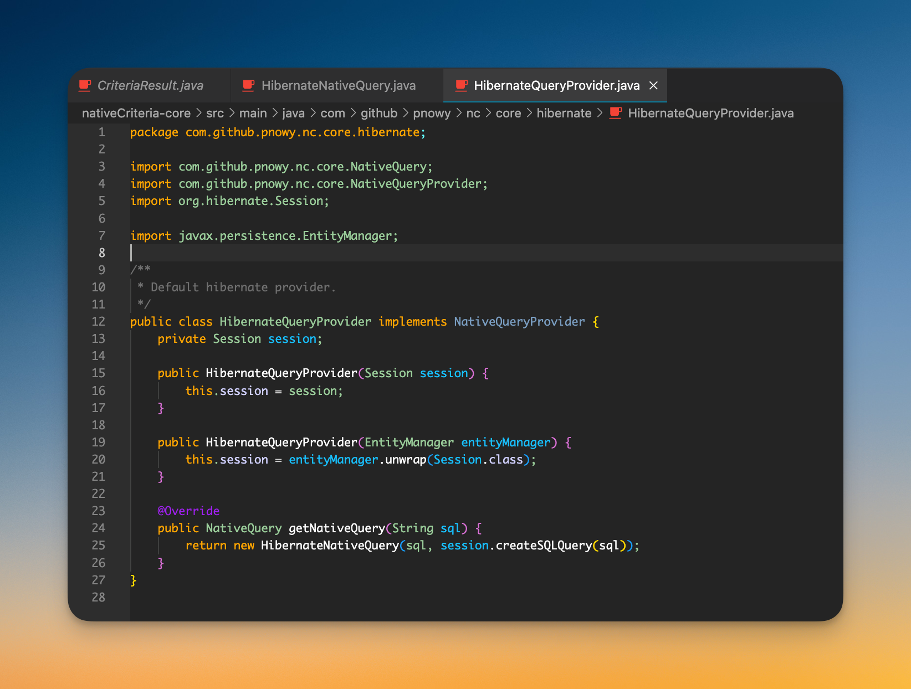

# Fulgora Visual Studio Code theme

A theme extension for [Visual Studio Code](https://code.visualstudio.com/) designed specifically for DevOps professionals, optimizing the development and operational workflow with a focus on clarity, efficiency, and seamless integration with daily tools.

## Screenshots

## Changelog

See [CHANGELOG.md](CHANGELOG.md)

## Intellij IDEA color scheme

If you are looking Intellij IDEA color schema you will find it on this [VS Code theme plugin](https://github.com/pnowy/fulgora/blob/main/intellij/fulgora.icls) repository.

In IntelliJ IDEA the main scheme is named **Fulgora (Default)**. To install a scheme, open Settings → Editor → Color Scheme, click ⚙ → Import Scheme and pick the `.icls` file. Re-import after updating, as IntelliJ keeps its own copy.

All schemes set their own Markdown code block, code fence, inline code and block quote backgrounds. Without them IntelliJ 2026.3 and later shows these with the light `Default` scheme's near-white background.

The VS Code theme follows IntelliJ IDEA's **Islands Dark** appearance with the **Fulgora (Default)** editor scheme. Rounded Islands panels can't be reproduced by a VS Code color theme, so only the colors match.

Every VS Code and Zed variant takes its diff and merge colors from the matching `.icls` scheme (`DIFF_INSERTED`, `DIFF_DELETED`, `DIFF_MODIFIED`, `DIFF_CONFLICT`). As in IntelliJ, changed words get the full color and the rest of a changed line a softer version of it. VS Code and Zed have no separate "modified" diff kind: a changed line shows green on the new side and grey on the old side, not IntelliJ's blue. The blue is used for merge conflicts and moved code instead.

## Dark BG

**Fulgora Dark BG** is identical to Fulgora Dark but keeps the original near-black `#0C0C0C` editor background instead of the Islands `#191A1C`. It is available for VS Code, Zed and IntelliJ IDEA ([fulgora-dark-bg.icls](intellij/fulgora-dark-bg.icls)).

## Sunset Drive

**Fulgora Sunset Drive** keeps the Fulgora Dark syntax colors and takes its appearance from Ghostty's **Sunset Drive** terminal theme: a `#0F0F1A` navy-black editor and window, a magenta accent, and the exact 16 ANSI colors in the integrated terminal. It is available for VS Code, Zed and IntelliJ IDEA ([fulgora-sunset-drive.icls](intellij/fulgora-sunset-drive.icls)).

## AI Dark and AI Light

**Fulgora (AI Dark)** and **Fulgora (AI Light)** are generated variants tuned for long sessions. They keep the Fulgora hue for every token type and change how bright and saturated each color is:

| Choice | AI Dark | AI Light | Why |
|--------|---------|----------|-----|
| Editor background | `#1E1F22` | `#FAFAF7` | Avoids pure black and pure white, which cause halation and glare |
| Text contrast | 11.4:1 | 13.3:1 | Well above WCAG AAA (7:1) without the 17–20:1 of white on black |
| Syntax colors | OKLCH lightness 0.80 | OKLCH lightness 0.50 | Equal perceived brightness, so no token type dominates |
| Comments | 4.8:1 | 4.7:1 | Quiet but still above WCAG AA (4.5:1) |
| Caret row and selection | Low-saturation tints | Low-saturation tints | No bright highlight band that pulls the eye |

Both are available for VS Code, Zed and IntelliJ IDEA ([fulgora-ai-dark.icls](intellij/fulgora-ai-dark.icls), [fulgora-ai-light.icls](intellij/fulgora-ai-light.icls)).

Static fields, interfaces and method kinds rely on semantic highlighting, so keep `editor.semanticHighlighting.enabled` at its default `configuredByTheme` value or set it to `true`.

## File icons

The extension also includes **Fulgora Icons**, built from IntelliJ's dark file and folder icons. Select it with `Preferences: File Icon Theme`. See [NOTICE](NOTICE) for attribution.

IntelliJ's module and source root folder markers depend on project structure, which a VS Code icon theme can't detect, so every folder uses the plain icon.

## Zed

The [`zed`](zed) directory contains a Zed version of the theme. To try it, run `zed: install dev extension` from the command palette, select the `zed` directory, then pick **Fulgora Dark**, **Fulgora Dark BG**, **Fulgora Sunset Drive**, **Fulgora (AI Dark)** or **Fulgora (AI Light)** with `theme selector: toggle`.

Zed themes can't set colors per language, so one color applies wherever a token type appears. For example, YAML keys use the property color and plain YAML values use the string color.

## Development

Open this repository in VS Code and press `F5` to start an Extension Development Host, then select **Fulgora**, **Fulgora Dark BG**, **Fulgora Sunset Drive**, **Fulgora (AI Dark)** or **Fulgora (AI Light)** with `Preferences: Color Theme`. Saving a file in `themes/` updates that window automatically.

**Enjoy!**
