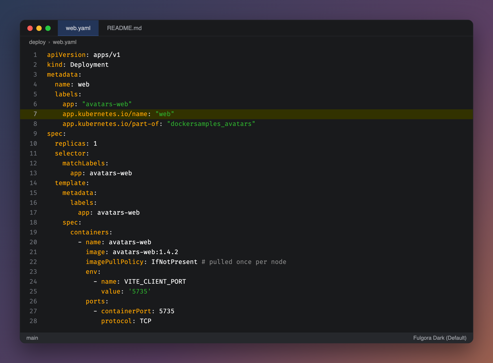
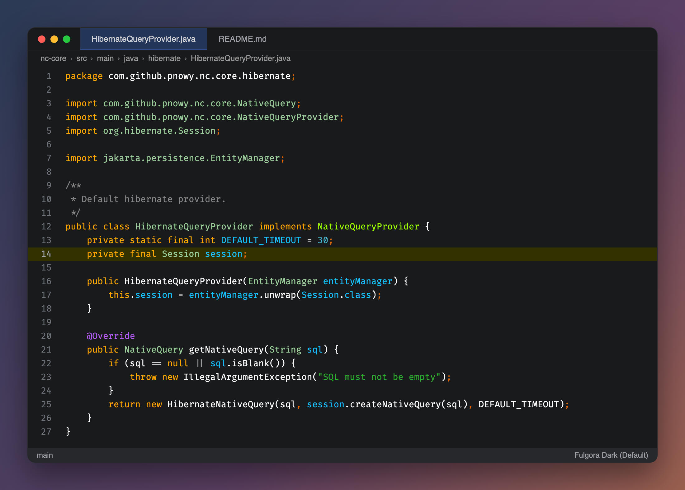
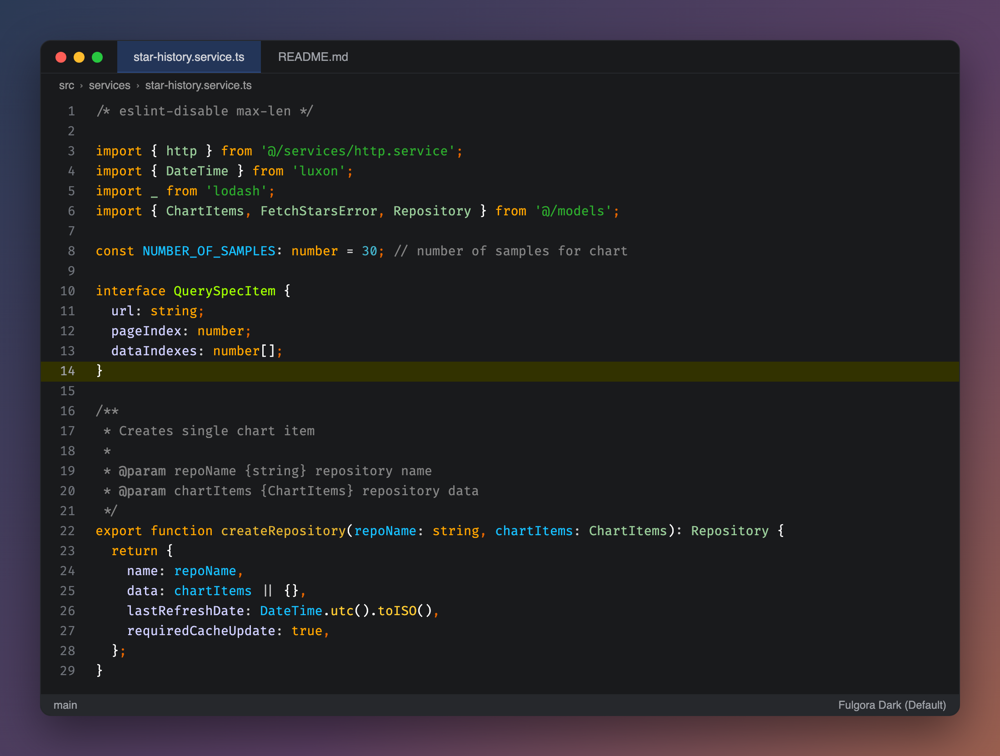
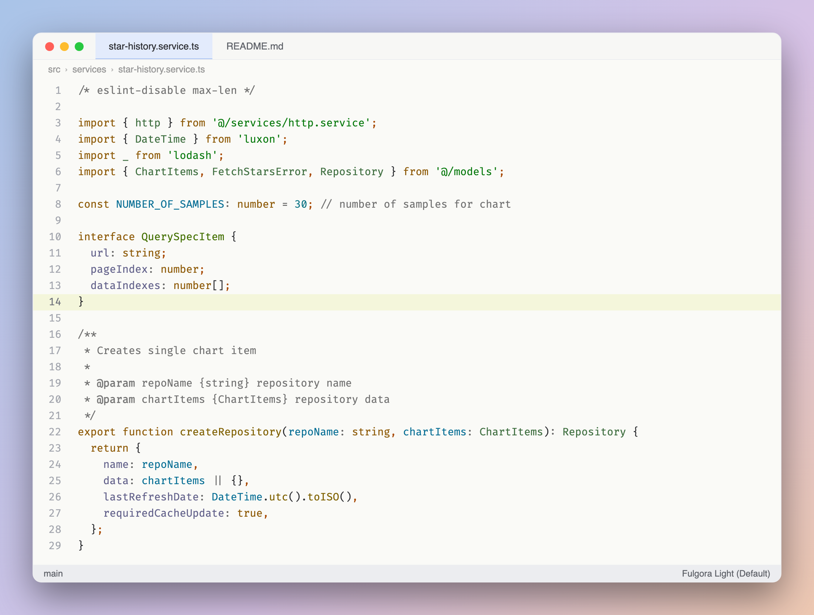
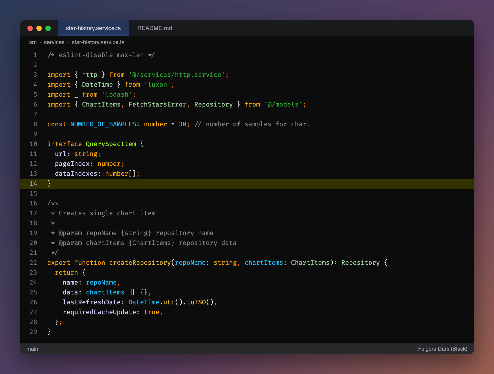
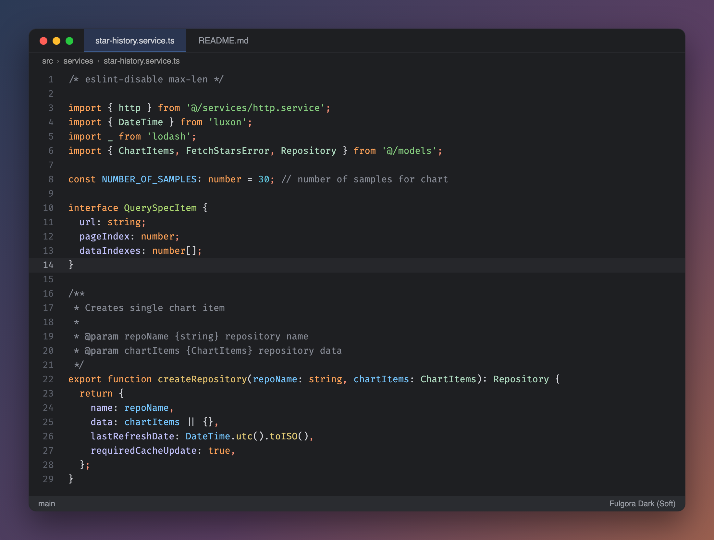
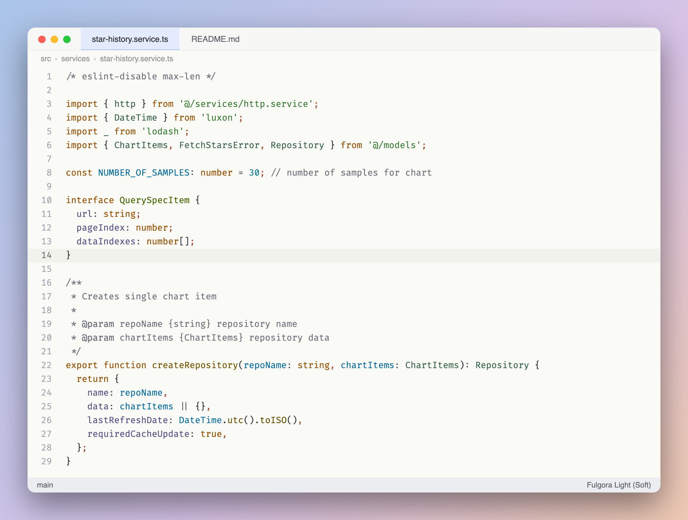
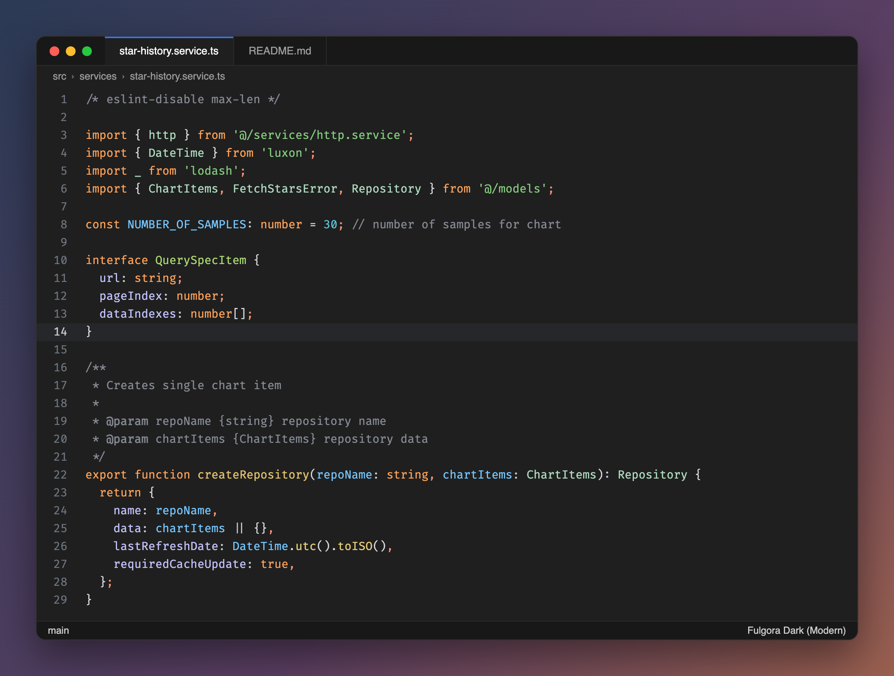
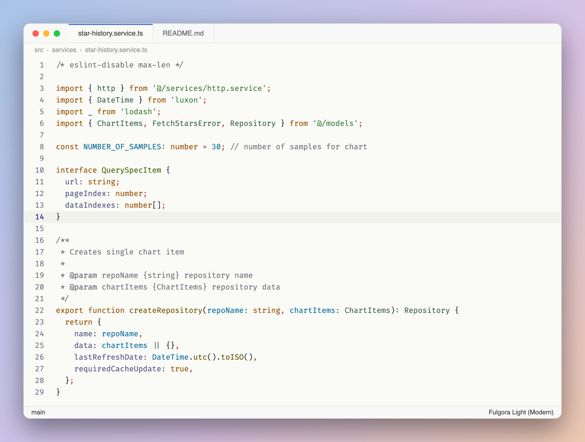

# Fulgora Visual Studio Code theme

A theme extension for [Visual Studio Code](https://code.visualstudio.com/) designed specifically for DevOps professionals, optimizing the development and operational workflow with a focus on clarity, efficiency, and seamless integration with daily tools.

## Screenshots

**Fulgora Dark (Default)** in YAML, TypeScript and Java:






### All variants

The same TypeScript file in each of the seven variants. Click an image to open it at full size.

| Family  | Dark                                                                                       | Light                                                                                        |
| ------- | ------------------------------------------------------------------------------------------ | -------------------------------------------------------------------------------------------- |
| Default |                     |                     |
| Black   |                         | —                                                                                            |
| Soft    |                           |                           |
| Modern  |                       |                       |

The screenshots are rendered from the VS Code theme files with TextMate highlighting only. In VS Code, semantic highlighting adds more colors for fields, parameters and local variables in languages such as Java and TypeScript.

## Changelog

See [CHANGELOG.md](CHANGELOG.md)

## Intellij IDEA color scheme

If you are looking Intellij IDEA color schema you will find it on this [VS Code theme plugin](https://github.com/pnowy/fulgora/blob/main/intellij/fulgora.icls) repository.

All seven variants exist in VS Code, Zed and IntelliJ IDEA under the same names: **Fulgora Dark (Default)** (the main theme), **Fulgora Light (Default)**, **Fulgora Dark (Black)**, **Fulgora Dark (Soft)**, **Fulgora Light (Soft)**, **Fulgora Dark (Modern)** and **Fulgora Light (Modern)**. Names start with Dark or Light so the pickers group them. A renamed variant has to be selected again in every editor.

To install an IntelliJ scheme, open Settings → Editor → Color Scheme, click ⚙ → Import Scheme and pick the `.icls` file. Re-import after updating, as IntelliJ keeps its own copy.

All schemes set their own Markdown code block, code fence, inline code and block quote backgrounds. Without them IntelliJ 2026.3 and later shows these with the light `Default` scheme's near-white background.

The VS Code theme follows IntelliJ IDEA's **Islands Dark** appearance with the **Fulgora Dark (Default)** editor scheme. Rounded Islands panels can't be reproduced by a VS Code color theme, so only the colors match.

Every variant takes its diff and merge colors from the matching `.icls` scheme (`DIFF_INSERTED`, `DIFF_DELETED`, `DIFF_MODIFIED`, `DIFF_CONFLICT`). As in IntelliJ, changed words get the full color and the rest of a changed line a softer version of it. VS Code and Zed have no separate "modified" diff kind: a changed line shows green on the new side and grey on the old side, not IntelliJ's blue. The blue is used for merge conflicts and moved code instead.

## Light (Default)

**Fulgora Light (Default)** is the light counterpart of Fulgora Dark (Default). It uses the Fulgora Light (Soft) window and keeps every Fulgora Dark syntax hue at its full saturation, darkened until it reaches at least 5.5:1 on the `#FAFAF7` background (comments 4.6:1). The caret row is a pale echo of the dark theme's olive (`#F4F6DB`) and the selection a pale green (`#C7E8D2`). Compared with Light (Soft), colors are more saturated and less evenly bright. It is available for VS Code, Zed and IntelliJ IDEA ([fulgora-light.icls](intellij/fulgora-light.icls)).

## Dark (Black)

**Fulgora Dark (Black)** is identical to Fulgora Dark (Default) but keeps the original near-black `#0C0C0C` editor background instead of the Islands `#191A1C`. It is available for VS Code, Zed and IntelliJ IDEA ([fulgora-dark-bg.icls](intellij/fulgora-dark-bg.icls)).

## Dark (Soft) and Light (Soft)

**Fulgora Dark (Soft)** and **Fulgora Light (Soft)** are generated variants tuned for long sessions. They keep the Fulgora hue for every token type and change how bright and saturated each color is:

| Choice                  | Dark (Soft)          | Light (Soft)         | Why                                                              |
|-------------------------|----------------------|----------------------|------------------------------------------------------------------|
| Editor background       | `#1E1F22`            | `#FAFAF7`            | Avoids pure black and pure white, which cause halation and glare |
| Text contrast           | 11.4:1               | 13.3:1               | Well above WCAG AAA (7:1) without the 17–20:1 of white on black  |
| Syntax colors           | OKLCH lightness 0.80 | OKLCH lightness 0.50 | Equal perceived brightness, so no token type dominates           |
| Comments                | 4.8:1                | 4.7:1                | Quiet but still above WCAG AA (4.5:1)                            |
| Caret row and selection | Low-saturation tints | Low-saturation tints | No bright highlight band that pulls the eye                      |

Both are available for VS Code, Zed and IntelliJ IDEA ([fulgora-ai-dark.icls](intellij/fulgora-ai-dark.icls), [fulgora-ai-light.icls](intellij/fulgora-ai-light.icls)).

Static fields, interfaces and method kinds rely on semantic highlighting, so keep `editor.semanticHighlighting.enabled` at its default `configuredByTheme` value or set it to `true`.

## Dark (Modern) and Light (Modern)

**Fulgora Dark (Modern)** and **Fulgora Light (Modern)** use the window of VS Code's built-in **Dark Modern** and **Light Modern** themes with the Fulgora blue accent instead of Microsoft blue, and the Fulgora Dark (Soft) and Light (Soft) syntax, selection, caret row, diff, merge and terminal colors. The light variant uses an off-white `#FAFAF7` background instead of pure white.

Markdown files use contrast-tuned VS Code syntax colors instead: in the dark variant blue `#69AFEA` headings and front matter keys and orange `#F39762` strings and inline code; in the light variant every color reaches at least 5.5:1.

Zed and IntelliJ IDEA have no VS Code window to copy, so there the Modern variants are Dark (Soft) and Light (Soft) on the Modern editor background (`#1F1F1F` dark), with the Modern line number and indent guide colors and terminal. Zed also takes the Modern title bar, status bar, panel and tab colors. The Markdown colors are VS Code-only. IntelliJ schemes: [fulgora-modern-dark.icls](intellij/fulgora-modern-dark.icls), [fulgora-modern-light.icls](intellij/fulgora-modern-light.icls).

## Markdown headings and code

The Default, Black and Soft variants use the same Markdown style in VS Code and Zed: bold headings in the regular text color, muted orange inline code and neutral gray code blocks. The gray is lighter than comments, so blocks don't look disabled. Code blocks tagged with a language (for example ` ```java `) keep that language's syntax colors, and frontmatter keeps the YAML colors. The Modern variants keep their own Markdown colors.

| Variant                      | Headings (bold) | Inline code | Code blocks |
| ---------------------------- | --------------- | ----------- | ----------- |
| Dark (Default), Dark (Black) | `#FFFFFF`       | `#E8A85C`   | `#C4C7CC`   |
| Dark (Soft)                  | `#D5D6DB`       | `#E3A06A`   | `#B6B8BF`   |
| Light (Default)              | `#2B2C30`       | `#8A5E22`   | `#4A4C52`   |
| Light (Soft)                 | `#2B2C30`       | `#94592A`   | `#4A4C52`   |

Zed has one color for inline code and code blocks, so it uses the inline code color for both.

Markdown links in Dark (Default) and Dark (Black) use `#4A9FE0`, a muted blue that is calmer than the saturated `#0099FF` and stays apart from the quote color.

## File icons

The extension also includes **Fulgora Icons**, built from IntelliJ's dark file and folder icons. Select it with `Preferences: File Icon Theme`. See [NOTICE](NOTICE) for attribution.

IntelliJ's module and source root folder markers depend on project structure, which a VS Code icon theme can't detect, so every folder uses the plain icon.

## Zed

The [`zed`](zed) directory contains a Zed version of the theme. To try it, run `zed: install dev extension` from the command palette, select the `zed` directory, then pick any of the seven Fulgora variants with `theme selector: toggle`.

Zed themes can't set colors per language, so one color applies wherever a token type appears. For example, YAML keys use the property color and plain YAML values use the string color.

## Development

Open this repository in VS Code and press `F5` to start an Extension Development Host, then select **Fulgora Dark (Default)**, **Fulgora Light (Default)**, **Fulgora Dark (Black)**, **Fulgora Dark (Soft)**, **Fulgora Light (Soft)**, **Fulgora Dark (Modern)** or **Fulgora Light (Modern)** with `Preferences: Color Theme`. Saving a file in `themes/` updates that window automatically.

**Enjoy!**
